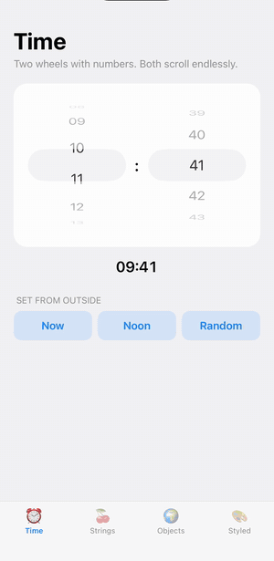
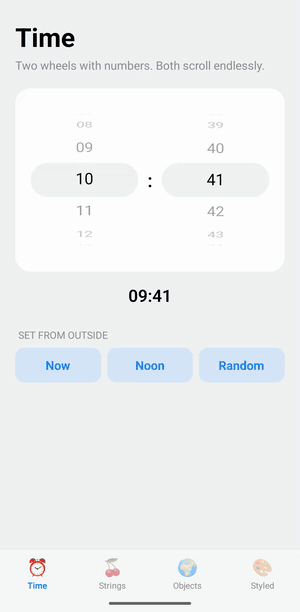

# react-native-next-wheel-picker

A wheel picker for React Native that picks any value — numbers, strings, enums or objects.

- **Android** — a native wheel drawn to look like iOS: rows on a 3D cylinder, faded toward the edges,
  a rounded selection band, fling with snapping, a haptic tick per row, light and dark mode.
- **iOS** — a native `UIPickerView`.
- Same props on both platforms, fully typed, generic over the value type.

| iOS                                            | Android                                                |
| ---------------------------------------------- | ------------------------------------------------------ |
|  |  |

Both recordings come from the [example app](example): two wheels share one controlled value, so
scrolling either moves the other, and the **First**, **Last** and **Random** buttons set the value
from outside.

## Installation

```sh
npm install react-native-next-wheel-picker
cd ios && pod install
```

Both platforms autolink; there are no other native dependencies.

Requires React Native 0.73 or newer (Android builds with JDK 17).

## Usage

```tsx
import { useState } from 'react';
import { WheelPicker } from 'react-native-next-wheel-picker';

const SIZES = [
  { label: 'Small', value: 's' },
  { label: 'Medium', value: 'm' },
  { label: 'Large', value: 'l' },
] as const;

export function SizePicker() {
  const [size, setSize] = useState<'s' | 'm' | 'l'>('m');

  return (
    <WheelPicker
      items={SIZES}
      value={size}
      onValueChange={(value) => setSize(value)}
      itemStyle={{ fontSize: 22, color: '#222' }}
    />
  );
}
```

### Setting the value from outside

A controlled wheel follows `value`: change it from anywhere and the wheel scrolls to the matching
row. This is what the **First**, **Last** and **Random** buttons in the recordings do:

```tsx
const MINUTES = Array.from({ length: 60 }, (_, i) => ({
  label: String(i).padStart(2, '0'),
  value: i,
}));

export function MinutePicker() {
  const [minute, setMinute] = useState(0);

  return (
    <>
      <WheelPicker items={MINUTES} value={minute} onValueChange={setMinute} />
      <Button title="First" onPress={() => setMinute(0)} />
      <Button title="Last" onPress={() => setMinute(59)} />
      <Button title="Random" onPress={() => setMinute(Math.floor(Math.random() * 60))} />
    </>
  );
}
```

`onValueChange` fires only when the user scrolls, not when `value` changes from outside.

Leave `value` out for an uncontrolled wheel: it starts on the first row and keeps its own position.

### Object values

Values are matched with `Object.is`. For objects that are not the same reference, pass `isEqual`:

```tsx
<WheelPicker
  items={users.map((user) => ({ label: user.name, value: user }))}
  value={selectedUser}
  isEqual={(a, b) => a.id === b.id}
  onValueChange={setSelectedUser}
/>
```

## Props

| Prop                | Type                                | Platform | Description                                                                                   |
| ------------------- | ----------------------------------- | -------- | --------------------------------------------------------------------------------------------- |
| `items`             | `{ label: string; value: T }[]`     | both     | Rows of the wheel. **Required.**                                                              |
| `onValueChange`     | `(value: T, index: number) => void` | both     | Called with the value of the row the wheel lands on. **Required.**                            |
| `value`             | `T`                                 | both     | Selected value; an unknown one selects the first row. Leave it out for an uncontrolled wheel. |
| `isEqual`           | `(a: T, b: T) => boolean`           | both     | Matches `value` against items. Defaults to `Object.is`.                                       |
| `style`             | `StyleProp<ViewStyle>`              | both     | Style of the view around the wheel.                                                           |
| `itemStyle`         | `StyleProp<TextStyle>`              | both     | Row text and wheel height; see below.                                                         |
| `selectionColor`    | `ColorValue`                        | both     | Fill of the band behind the selected row. Defaults to the system's.                           |
| `themeVariant`      | `'light' \| 'dark'`                 | both     | Forces light or dark default colors. Defaults to the system appearance.                       |
| `testID`            | `string`                            | both     |                                                                                               |
| `wrapSelectorWheel` | `boolean`                           | both     | Scroll endlessly: the first row follows the last. Default `false`.                            |

`itemStyle` works the same on both platforms:

- `fontSize` (default 21), `color`, `fontFamily`, `fontWeight` and `fontStyle` style the rows.
  The font resolves like `<Text>` does.
- `height` is the wheel's height, default 216. Each row is the font's line height plus 20.

A parent that ignores a change, by keeping its old `value`, snaps the wheel back on both platforms.

## Development

```sh
npm install
npm test
npm run typecheck
npm run lint
npm run build   # writes lib/
```

[`example/`](example) is a playground app with toggles for every prop, the value and the item
set. It runs the library from `src/`:

```sh
cd example && npm install
npm run pods      # iOS only
npm run android   # or: npm run ios
```

The GIFs in `docs/` are recorded from the example app. With Metro running, the app installed and
`ffmpeg` and [`axe`](https://github.com/cameroncooke/AXe) on the path, these scripts replay the same
gestures and rewrite the GIFs:

```sh
scripts/gifs/record-ios.sh       # booted iPhone 17 Pro simulator
scripts/gifs/record-android.sh   # running 1080x2280 emulator
```

The taps and swipes use fixed coordinates, so other screen sizes need new ones.

## Releasing

1. Bump `version` in `package.json` and add a `CHANGELOG.md` entry.
2. Commit, then tag and push: `git tag v1.2.3 && git push origin main v1.2.3`.
3. The `publish` workflow checks, builds and runs `npm publish --provenance`.

The workflow authenticates with the `NPM_TOKEN` repository secret. Once the package exists on npm,
it can switch to [trusted publishing](https://docs.npmjs.com/trusted-publishers) and the secret can go.

## License

MIT
