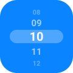

<div align="center">



# react-native-next-wheel-picker

**A native wheel picker for React Native that picks any value: numbers, strings, enums or objects.**

[](https://www.npmjs.com/package/react-native-next-wheel-picker)
[](https://github.com/devmaxxx/react-native-next-wheel-picker/actions/workflows/ci.yml)
[](LICENSE)
[](#why-this-picker)
[](src/types.ts)
[](#expo)

|                      iOS                       |                        Android                         |
| :--------------------------------------------: | :----------------------------------------------------: |
|  |  |

**[▶ Try the live demo](https://devmaxxx.github.io/react-native-next-wheel-picker/)** in the browser

<sub>Recorded from the <a href="example-expo">Expo demo</a>: flicking the wheels, setting the value
from outside, and the string, object and styled tabs.</sub>

</div>

## Why this picker

- 🎡 **Native on both platforms.** iOS uses `UIPickerView`. Android draws its own wheel to look like
  iOS: rows on a 3D cylinder, faded edges, a rounded selection band, fling with snapping and a
  haptic tick per row.
- 🧬 **Any value type.** `WheelPicker<T>` is generic: give it numbers, string unions, enums or
  objects and `onValueChange` hands back the same `T`, fully typed.
- 🎛️ **Controlled or uncontrolled.** Set the value from outside and the wheel scrolls to it. Keep the
  old value and the wheel snaps back.
- ♾️ **Infinite scroll** with `loop`, on both platforms.
- 🎨 **One styling API.** `itemStyle`, `selectionColor` and `colorScheme` behave the same on iOS and
  Android, light and dark.
- 🌐 **Runs everywhere.** Where the native view is missing, in Expo Go, Snack or on the web, the
  same component renders a JS wheel with the same props.
- 📦 **No dependencies.** Nothing to install besides the package itself, and it autolinks.

## Contents

- [Installation](#installation)
- [Quick start](#quick-start)
- [Recipes](#recipes)
  - [Setting the value from outside](#setting-the-value-from-outside)
  - [Rejecting a change](#rejecting-a-change)
  - [Uncontrolled](#uncontrolled)
  - [Objects](#objects)
  - [Time picker with infinite scroll](#time-picker-with-infinite-scroll)
  - [Styling and dark mode](#styling-and-dark-mode)
- [API](#api)
- [How it compares](#how-it-compares)
- [Troubleshooting](#troubleshooting)
- [Examples](#examples)
- [Development](#development)
- [Contributing](#contributing)
- [License](#license)

## Installation

```sh
npm install react-native-next-wheel-picker
cd ios && pod install
```

Requires React Native 0.73 or newer; Android builds with JDK 17.

### Expo

In Expo Go, Snack and on the web the picker renders its JS wheel, so it works right after
`npx expo install`. For the native wheel, use a
[development build](https://docs.expo.dev/develop/development-builds/introduction/); it needs no
config plugin, autolinking picks it up during prebuild.

1. Install it:

   ```sh
   npx expo install react-native-next-wheel-picker
   ```

2. For the native wheel, build the app with its native code, locally or on EAS:

   ```sh
   npx expo run:ios                        # or: npx expo run:android
   eas build --profile development         # or any profile of yours
   ```

3. Use it like any other component, in Expo Router screens too:

   ```tsx
   import { WheelPicker } from 'react-native-next-wheel-picker';
   ```

Rebuild after installing or upgrading the package; JS changes alone reload as usual. Add
[`expo-dev-client`](https://docs.expo.dev/versions/latest/sdk/dev-client/) to keep the
`npx expo start` + QR workflow with your own build.

## Quick start

```tsx
import { useState } from 'react';
import { WheelPicker } from 'react-native-next-wheel-picker';

const SIZES = [
  { label: 'Small', value: 's' },
  { label: 'Medium', value: 'm' },
  { label: 'Large', value: 'l' },
] as const;

export function SizePicker() {
  const [size, setSize] = useState<'s' | 'm' | 'l'>('m');

  return <WheelPicker items={SIZES} value={size} onValueChange={setSize} />;
}
```

`items` is a list of `{ label, value }`. The wheel shows the labels and reports the values.

## Recipes

### Setting the value from outside

A controlled wheel follows `value`. Change it from anywhere and the wheel scrolls to the matching
row; this is what the **First**, **Last** and **Random** buttons in the recordings do.

```tsx
const FRUITS = [
  { label: '🍎 Apple', value: 'apple' },
  { label: '🍒 Cherry', value: 'cherry' },
  { label: '🍋 Lemon', value: 'lemon' },
] as const;

type Fruit = (typeof FRUITS)[number]['value'];

export function FruitPicker() {
  const [fruit, setFruit] = useState<Fruit>('cherry');

  return (
    <>
      <WheelPicker items={FRUITS} value={fruit} onValueChange={setFruit} />
      <Button title="First" onPress={() => setFruit('apple')} />
      <Button title="Last" onPress={() => setFruit('lemon')} />
    </>
  );
}
```

`onValueChange` fires only when the user scrolls, never for a value set from outside. A value that
matches no item selects the first row.

### Rejecting a change

The wheel always shows `value`. A parent that ignores a change, by keeping its old `value`, snaps the
wheel back:

```tsx
<WheelPicker
  items={SEATS}
  value={seat}
  onValueChange={(next) => {
    if (!next.taken) setSeat(next);
  }}
/>
```

### Uncontrolled

Leave `value` out and the wheel keeps its own position, starting on the first row:

```tsx
<WheelPicker items={SIZES} onValueChange={(size) => console.log(size)} />
```

### Objects

Without `keyExtractor`, `value` is compared to the items with `Object.is`, so an object must be the
very same reference as one of the items. That breaks as soon as the selection comes from somewhere
else: a refetch, persisted state or navigation params. `keyExtractor` returns the identity to compare
instead:

```tsx
type User = { id: string; name: string };

export function AssigneePicker({ users, assignee, onAssign }: Props) {
  // `assignee` came from another request, so it is a different object than the item in `users`.
  return (
    <WheelPicker
      items={users.map((user) => ({ label: user.name, value: user }))}
      value={assignee}
      keyExtractor={(user) => user.id}
      onValueChange={onAssign}
    />
  );
}
```

`onValueChange` still hands back the item's object, not the key.

### Time picker with infinite scroll

`loop` puts the first row after the last, so the wheel scrolls without end:

```tsx
const pad = (n: number) => String(n).padStart(2, '0');
const HOURS = Array.from({ length: 24 }, (_, i) => ({ label: pad(i), value: i }));
const MINUTES = Array.from({ length: 60 }, (_, i) => ({ label: pad(i), value: i }));

export function TimePicker() {
  const [hour, setHour] = useState(9);
  const [minute, setMinute] = useState(41);

  return (
    <View style={{ flexDirection: 'row' }}>
      <WheelPicker style={{ flex: 1 }} items={HOURS} value={hour} onValueChange={setHour} loop />
      <WheelPicker
        style={{ flex: 1 }}
        items={MINUTES}
        value={minute}
        onValueChange={setMinute}
        loop
      />
    </View>
  );
}
```

### Styling and dark mode

```tsx
<WheelPicker
  items={SIZES}
  value={size}
  onValueChange={setSize}
  colorScheme="dark"
  selectionColor="#0a84ff66"
  itemStyle={{ fontSize: 28, fontWeight: '700', color: '#ffffff', height: 180 }}
/>
```

- `itemStyle` takes `fontSize` (default 21), `color`, `fontFamily`, `fontWeight` and `fontStyle`.
  Fonts resolve the way `<Text>` resolves them.
- `itemStyle.height` is the wheel's height, default 216. Each row is the font's line height plus 20.
- Without colors the wheel follows the system appearance; `colorScheme` forces light or dark.
- Android accepts `#RGB`, `#RRGGBBAA`, `rgb()` and `PlatformColor` for every color, and reads
  `fontSize` in sp like the rest of React Native.

## API

### `<WheelPicker<T>>`

| Prop                 | Type                                | Default      | Description                                                  |
| -------------------- | ----------------------------------- | ------------ | ------------------------------------------------------------ |
| `items`              | `{ label: string; value: T }[]`     | **required** | Rows of the wheel.                                           |
| `onValueChange`      | `(value: T, index: number) => void` | **required** | Called with the value of the row the user's scroll lands on. |
| `value`              | `T`                                 | —            | Selected value. Leave it out for an uncontrolled wheel.      |
| `keyExtractor`       | `(value: T) => string \| number`    | —            | Identity used to match `value` to an item, e.g. an id.       |
| `loop`               | `boolean`                           | `false`      | Scroll endlessly: the first row follows the last.            |
| `itemStyle`          | `StyleProp<TextStyle>`              | —            | Row font and color, and the wheel's `height`.                |
| `selectionColor`     | `ColorValue`                        | system fill  | Fill of the band behind the selected row.                    |
| `colorScheme`        | `'light' \| 'dark'`                 | system       | Forces light or dark default colors.                         |
| `style`              | `StyleProp<ViewStyle>`              | —            | Style of the view around the wheel.                          |
| `accessibilityLabel` | `string`                            | —            | What the wheel picks, read before the value, e.g. `"Hour"`.  |
| `testID`             | `string`                            | —            | Test identifier.                                             |

Every prop works the same on iOS and Android, and in the JS wheel. Screen readers get one adjustable
control per wheel (swipe up or down to change it). On the web the wheel snaps with CSS scroll
snapping, a click on a row turns to it, and a focused wheel takes the arrow keys, Page Up/Down,
Home and End. The package also exports the `WheelPickerItem<T>` and
`WheelPickerProps<T>` types.

## How it compares

|                          | **next-wheel-picker**  | [`@react-native-picker/picker`](https://github.com/react-native-picker/picker) | JS wheels (FlatList or Reanimated based) |
| ------------------------ | :--------------------: | :----------------------------------------------------------------------------: | :--------------------------------------: |
| iOS                      |  native UIPickerView   |                              native UIPickerView                               |               JS imitation               |
| Android                  | native iOS-style wheel |                               dropdown or dialog                               |               JS imitation               |
| Same look on both        |           ✅           |                                       ❌                                       |                    ✅                    |
| Typed values of any kind |           ✅           |                              strings and numbers                               |                  varies                  |
| Infinite scroll          |           ✅           |                                       ❌                                       |                  varies                  |
| Runs in Expo Go and web  |    ✅ (JS fallback)    |                                       ✅                                       |                    ✅                    |

The fallback keeps Expo Go and the web working; a development build gets the platform's own
scrolling and haptics.

## Troubleshooting

<details>
<summary>The wheel looks or feels different from the native one</summary>

The app runs without the picker's native code, so it renders the JS wheel: it is Expo Go, Snack, the
web, or a native app not rebuilt after installing. Rebuild with `npx expo run:ios`,
`npx expo run:android`, or `cd ios && pod install` and a fresh build.

</details>

<details>
<summary><code>onValueChange</code> does not fire when I set <code>value</code></summary>

By design: it reports the user's scrolls only. A value you set is already known to you, and a callback
for it would loop with a parent that stores it.

</details>

<details>
<summary>The wheel shows the first row instead of my object</summary>

The `value` object is not the same reference as an item's. Pass `keyExtractor`, see
[Objects](#objects).

</details>

<details>
<summary>The wheel is too tall or too short</summary>

The wheel's height is `itemStyle.height` (default 216), not `style.height`, the same as React
Native's iOS picker. `style` sizes the view around it.

</details>

## Examples

| App                             | What it is                                                                          | Run it                                                     |
| ------------------------------- | ----------------------------------------------------------------------------------- | ---------------------------------------------------------- |
| [`example-expo/`](example-expo) | Expo demo with a tab per use case: time, strings, objects and styling.              | `cd example-expo && npm install && npm run ios`            |
| [`example/`](example)           | Bare React Native playground with a toggle for every prop, the value and the items. | `cd example && npm install && npm run pods && npm run ios` |

Both run the library from `src/`, so edits show up on reload. Swap `ios` for `android` to run on
Android.

## Development

```sh
npm install
npm test
npm run typecheck
npm run lint
npm run build   # writes lib/
```

### Recording the GIFs

The GIFs in `docs/` are recorded from the Expo demo. With Metro running, the demo installed, and
`ffmpeg` and [`axe`](https://github.com/cameroncooke/AXe) on the path, these scripts replay the same
gestures and rewrite the GIFs:

```sh
scripts/gifs/record-ios.sh       # booted iPhone 17 Pro simulator
scripts/gifs/record-android.sh   # running 1080x2280 emulator
```

The taps and swipes use fixed coordinates, so other screen sizes need new ones.

### Releasing

1. Bump `version` in `package.json` and add a `CHANGELOG.md` entry.
2. Commit, then tag and push: `git tag v1.2.3 && git push origin main v1.2.3`.
3. The `publish` workflow checks the tag against the version, builds and publishes with
   [trusted publishing](https://docs.npmjs.com/trusted-publishers): no token, and npm adds
   provenance on its own.

npm sets up a trusted publisher only for a package that already exists, so the first version goes
out by hand (`npm login`, then `npm publish --access public`). After that, add this repo and
`publish.yml` as the trusted publisher on npmjs.com, and the tags take over.

## Contributing

Issues and pull requests are welcome. Run `npm test`, `npm run typecheck` and `npm run lint` before
opening one, and add a test for any behavior change. Visual changes on either platform are easiest
to review with a GIF from [`scripts/gifs`](scripts/gifs).

## License

[MIT](LICENSE) © [devmaxxx](https://github.com/devmaxxx)
